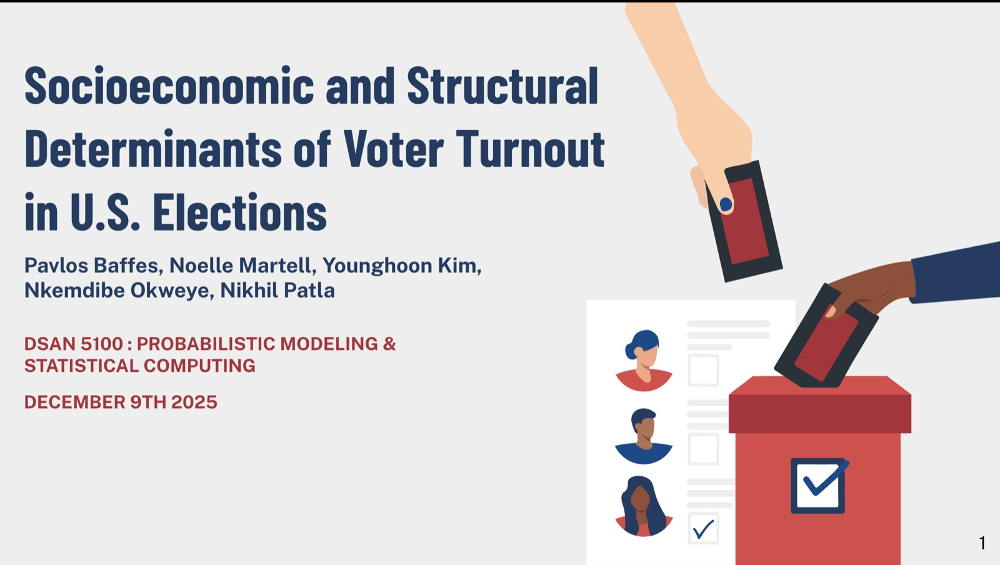

```{=html}
<div class="wrap hero">
  <div>
    <span class="avail">Open to full-time data roles in 2027</span>
    <h1>I turn messy data into <em>decisions</em> people trust.</h1>
    <p class="hero-lede">I’m a data scientist at Georgetown’s School of Medicine and an MS candidate in Data Science &amp; Analytics. I build the pipelines, data models and dashboards that pull scattered sources into one clear picture teams can act on.</p>
    <div class="btns">
      <a class="btn-pill p" href="#work">See selected work ↓</a>
      <a class="btn-pill s" href="resume.html">Résumé</a>
      <a class="btn-pill s" href="assets/files/Nkemdibe_Okweye_Resume.pdf" download>Download PDF ↓</a>
    </div>
    <div class="creds">
      <div><span class="lg"></span><span><b>Georgetown Medicine</b>Data Scientist</span></div>
      <div><span class="lg white"></span><span><b>AL-Monitor</b>Analytics Intern</span></div>
      <div><span class="lg white"></span><span><b>National Defence</b>Data Analyst</span></div>
    </div>
  </div>
  <div class="portrait-wrap">
    <div class="portrait"></div>
  </div>
</div>

<section class="featured" id="featured" aria-label="Featured in">
  <div class="wrap">
    <header class="sec-head">
      <div><div class="meta">Featured</div><h2 class="h2">Featured in</h2></div>
    </header>
  </div>
  <div class="marquee">
    <div class="mtrack">
      <a class="fcard" href="https://analytics.georgetown.edu/news-story/nkemdibe-okweye-27/" target="_blank" rel="noopener"><div class="fsrc"><span class="fbadge"></span><span>Georgetown DSAN</span></div><h3>Student profile Q&amp;A</h3><p>My path from accounting to data science.</p><span class="fcta">Read the profile ↗</span></a>
      <a class="fcard" href="https://www.linkedin.com/feed/update/urn:li:activity:7478104424436015104/" target="_blank" rel="noopener"><div class="fsrc"><span class="fbadge li" aria-hidden="true">in</span><span>LinkedIn</span></div><h3>DSAN student spotlight</h3><p>Why I chose Georgetown’s DSAN program.</p><span class="fcta">View post ↗</span></a>
      <a class="fcard" href="https://www.linkedin.com/feed/update/urn:li:activity:7459570725230698498/" target="_blank" rel="noopener"><div class="fsrc"><span class="fbadge li" aria-hidden="true">in</span><span>LinkedIn</span></div><h3>Poster session</h3><p>Presenting our Statistical Learning research.</p><span class="fcta">View post ↗</span></a>
      <a class="fcard" href="https://www.instagram.com/reel/DWJo4BdDzmY/" target="_blank" rel="noopener"><div class="fsrc"><span class="fbadge ig" aria-hidden="true"><svg viewBox="0 0 24 24" width="16" height="16" fill="none" stroke="currentColor" stroke-width="2"><rect x="3" y="3" width="18" height="18" rx="5"/><circle cx="12" cy="12" r="4"/><circle cx="17.5" cy="6.5" r="1" fill="currentColor" stroke="none"/></svg></span><span>Instagram</span></div><h3>Women in STEM</h3><p>A Women’s History Month feature with Noelle Martell.</p><span class="fcta">Watch the reel ↗</span></a>
      <a class="fcard" href="https://www.instagram.com/reel/Dbbb8SUD2y0/" target="_blank" rel="noopener"><div class="fsrc"><span class="fbadge ig" aria-hidden="true"><svg viewBox="0 0 24 24" width="16" height="16" fill="none" stroke="currentColor" stroke-width="2"><rect x="3" y="3" width="18" height="18" rx="5"/><circle cx="12" cy="12" r="4"/><circle cx="17.5" cy="6.5" r="1" fill="currentColor" stroke="none"/></svg></span><span>Instagram</span></div><h3>A day at AL-Monitor</h3><p>A day in the life of my summer internship.</p><span class="fcta">Watch the reel ↗</span></a>
    </div>
    <div class="mtrack" aria-hidden="true">
      <a class="fcard" href="https://analytics.georgetown.edu/news-story/nkemdibe-okweye-27/" target="_blank" rel="noopener" tabindex="-1"><div class="fsrc"><span class="fbadge"></span><span>Georgetown DSAN</span></div><h3>Student profile Q&amp;A</h3><p>My path from accounting to data science.</p><span class="fcta">Read the profile ↗</span></a>
      <a class="fcard" href="https://www.linkedin.com/feed/update/urn:li:activity:7478104424436015104/" target="_blank" rel="noopener" tabindex="-1"><div class="fsrc"><span class="fbadge li" aria-hidden="true">in</span><span>LinkedIn</span></div><h3>DSAN student spotlight</h3><p>Why I chose Georgetown’s DSAN program.</p><span class="fcta">View post ↗</span></a>
      <a class="fcard" href="https://www.linkedin.com/feed/update/urn:li:activity:7459570725230698498/" target="_blank" rel="noopener" tabindex="-1"><div class="fsrc"><span class="fbadge li" aria-hidden="true">in</span><span>LinkedIn</span></div><h3>Poster session</h3><p>Presenting our Statistical Learning research.</p><span class="fcta">View post ↗</span></a>
      <a class="fcard" href="https://www.instagram.com/reel/DWJo4BdDzmY/" target="_blank" rel="noopener" tabindex="-1"><div class="fsrc"><span class="fbadge ig" aria-hidden="true"><svg viewBox="0 0 24 24" width="16" height="16" fill="none" stroke="currentColor" stroke-width="2"><rect x="3" y="3" width="18" height="18" rx="5"/><circle cx="12" cy="12" r="4"/><circle cx="17.5" cy="6.5" r="1" fill="currentColor" stroke="none"/></svg></span><span>Instagram</span></div><h3>Women in STEM</h3><p>A Women’s History Month feature with Noelle Martell.</p><span class="fcta">Watch the reel ↗</span></a>
      <a class="fcard" href="https://www.instagram.com/reel/Dbbb8SUD2y0/" target="_blank" rel="noopener" tabindex="-1"><div class="fsrc"><span class="fbadge ig" aria-hidden="true"><svg viewBox="0 0 24 24" width="16" height="16" fill="none" stroke="currentColor" stroke-width="2"><rect x="3" y="3" width="18" height="18" rx="5"/><circle cx="12" cy="12" r="4"/><circle cx="17.5" cy="6.5" r="1" fill="currentColor" stroke="none"/></svg></span><span>Instagram</span></div><h3>A day at AL-Monitor</h3><p>A day in the life of my summer internship.</p><span class="fcta">Watch the reel ↗</span></a>
    </div>
  </div>
</section>

<section class="xp" id="experience">
  <div class="wrap">
    <header class="sec-head">
      <div><div class="meta">Experience</div><h2 class="h2">Where I’ve worked</h2></div>
      <p>Three roles across healthcare, media and government, all about getting the right numbers to the people making decisions.</p>
    </header>
    <ol class="rail">
      <li class="xjob now">
        <span class="node"></span>
        <article>
          <div class="xtop"><div><span class="pill">Now</span><h3>Work-Study Data Scientist</h3><div class="org">Georgetown University School of Medicine · Washington, DC</div></div><span class="when">Jul 2026 – Present</span></div>
          <div class="xbody">
            <ul>
              <li>Modeled <b>6 years</b> of residency readiness survey data as a star schema, powering a multi-page dashboard comparing Georgetown with national results.</li>
              <li>Python pipeline that ingests national and school-level survey data into one dataset, replacing manual Excel cleanup.</li>
              <li>Net Readiness Score weighted by respondent count, so small specialties don’t distort the comparison.</li>
              <li>Clinical exam score reports across <b>6 clerkships</b> combined into one historical dataset back to 2016, with built-in quality checks.</li>
            </ul>
            <div class="kpi"><b>17</b><span>competencies benchmarked against national results</span></div>
          </div>
          <div class="chips"><span>Python</span><span>Star schema</span><span>Dashboards</span><span>Data quality</span></div>
        </article>
      </li>
      <li class="xjob">
        <span class="node white"></span>
        <article>
          <div class="xtop"><div><h3>Analytics &amp; Data Intern</h3><div class="org">AL-Monitor · Washington, DC</div></div><span class="when">Apr – Aug 2026</span></div>
          <div class="xbody">
            <ul>
              <li>Python pipelines pulling subscriber counts, MRR and churn from the Chargebee API to automate the monthly KPI report.</li>
              <li>Automated the Waterfall report on subscription health across individual, group and omnichannel plans.</li>
              <li>Partnered with 3 senior editors to build a Looker Studio report joining article and newsletter campaign performance.</li>
              <li>Maintained daily and monthly dashboards and delivered ad hoc analysis for editorial, marketing and leadership.</li>
            </ul>
            <div class="kpi"><b>~3 hrs</b><span>of manual work saved on every monthly KPI report</span></div>
          </div>
          <div class="chips"><span>Python</span><span>REST APIs</span><span>Looker Studio</span><span>Subscription metrics</span></div>
        </article>
      </li>
      <li class="xjob">
        <span class="node white"></span>
        <article>
          <div class="xtop"><div><h3>Data Analyst</h3><div class="org">Department of National Defence · Ottawa</div></div><span class="when">Sep 2023 – Aug 2025</span></div>
          <div class="xbody">
            <ul>
              <li>SQL transforming <b>500K+</b> records from SAP ERP, SQL warehouses, Lakehouse and CRM sources for Power BI.</li>
              <li>Power BI dashboards and Excel reporting tools used by <b>200+</b> stakeholders, plus KPI briefings for all levels of the organization.</li>
              <li>Worked with data engineers and SMEs to turn business requirements into pipeline specs and data models.</li>
              <li>Intake portal built with Power Automate and Azure DevOps.</li>
            </ul>
            <div class="kpi"><b>80%</b><span>less manual data entry after the intake portal launched</span></div>
          </div>
          <div class="chips"><span>SQL</span><span>Power BI</span><span>Power Automate</span><span>Azure DevOps</span></div>
        </article>
      </li>
    </ol>
    <header class="sec-head edu-head" id="education">
      <div><div class="meta">Education</div><h2 class="h2">Where I’ve studied</h2></div>
    </header>
    <div class="edu2">
      <div class="school"><div><div class="meta">2025 – 2027 · in progress</div><h3>MS, Data Science &amp; Analytics</h3><p>Georgetown University · Washington, DC</p></div></div>
      <div class="school"><div><div class="meta">2020 – 2024</div><h3>Hon. BCom, Business Technology Management</h3><p>University of Ottawa · Ottawa</p></div></div>
    </div>
  </div>
</section>

<section class="pj" id="work">
  <div class="wrap">
    <header class="sec-head">
      <div><div class="meta">Selected work</div><h2 class="h2">Projects</h2></div>
      <p>Class projects and team research from Georgetown, each with the data, method and result.</p>
    </header>
    <div class="pgrid">
      <a class="pcard big" href="projects/vanishing-entry-point.html">
        <div class="pimg"><span class="cat">Data viz · D3</span></div>
        <div class="pbody">
          <div class="meta">DSAN 5200 · 2026 · with Noelle Martell</div>
          <h3>The Vanishing Entry Point</h3>
          <p>Why the job market got harder for new grads. Five datasets (BLS JOLTS, NY Fed, NCES, Google Trends, Georgetown CEW) in an interactive story with Chart.js and a D3 explorer of 74 majors.</p>
          <div class="pstats"><div><b>46%</b><span>fewer hires than postings implied</span></div><div><b>~42%</b><span>of recent grads underemployed</span></div><div><b>74</b><span>majors in the D3 explorer</span></div></div>
          <span class="go">Read the case study →</span>
        </div>
      </a>
      <a class="pcard" href="projects/voter-turnout.html">
        <div class="pimg"><span class="cat">Statistics · R</span></div>
        <div class="pbody"><div class="meta">DSAN 5100 · Dec 2025</div><h3>What actually drives Americans to vote?</h3><p>23 elections in six states, tested against unemployment, housing, crime and weather.</p>
          <div class="find"><b>+5.47 pts</b> swing vs. blue states · p = 0.0012</div><span class="go">Case study →</span></div>
      </a>
      <a class="pcard" href="projects/menendez-narratives.html">
        <div class="pimg"><span class="cat">NLP · Python</span></div>
        <div class="pbody"><div class="meta">DSAN 5000 · 2025</div><h3>The Menendez Brothers, from courtroom to comments</h3><p>2,840 documents tracing 35 years of shifting public narrative.</p>
          <div class="find"><b>96.8%</b> test accuracy, Naive Bayes classifier</div><span class="go">Case study →</span></div>
      </a>
      <a class="pcard" href="projects/airline-performance.html">
        <div class="pimg"><span class="cat">SQL · PostgreSQL</span></div>
        <div class="pbody"><div class="meta">DSAN 6300 · 2025</div><h3>A deep dive into U.S. airline performance</h3><p>A star schema over 600,000+ DOT flight records.</p>
          <div class="find"><b>2,620 min</b> longest delay found</div><span class="go">Case study →</span></div>
      </a>
    </div>
    <div class="more"><span>+ 4 more: request portal, Binge movie app, review clustering, dog adoption app</span><a class="btn-pill s" href="work.html">All projects →</a></div>
  </div>
</section>

<section class="contact-band" id="contact">
  <div class="wrap">
    <div><h2>Hiring for a data role? Let’s talk.</h2><p>Email me or send a message on LinkedIn. I usually reply within a day.</p></div>
    <div class="contact-list">
      <a href="mailto:nkemokweye@gmail.com">Email <span>nkemokweye@gmail.com ↗</span></a>
      <a href="https://www.linkedin.com/in/nkemdibe-okweye-639059200/">LinkedIn <span>nkemdibe-okweye ↗</span></a>
      <a href="https://github.com/nko123">GitHub <span>nko123 ↗</span></a>
      <a href="resume.html">Résumé <span>Read online →</span></a>
      <a href="assets/files/Nkemdibe_Okweye_Resume.pdf" download>Résumé PDF <span>Download ↓</span></a>
    </div>
  </div>
</section>
```
