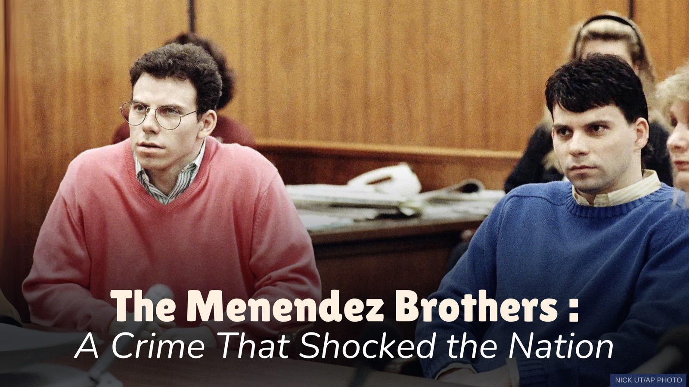

```{=html}
<div class="cs-facts">
  <div><span>Type</span>Semester project</div>
  <div><span>Course</span>DSAN 5000, Data Science &amp; Analytics</div>
  <div><span>Data</span>2,840+ documents · 1989–2024</div>
  <div><span>Tools</span>Python, scikit-learn, NLTK</div>
</div>

```

## The question

In 1989 Lyle and Erik Menendez killed their parents in Beverly Hills. Coverage moved from tabloid sensation to a Netflix-era reappraisal of abuse and justice. I measured how that narrative changed across three decades and across platforms.

## Data

A pipeline pulling 2,840+ documents from the Guardian API, the YouTube Data API v3 and historical archives, cleaned through a repeatable ETL workflow.

## Method

```{=html}
<div class="methods"><span>TF-IDF</span><span>Multinomial Naive Bayes</span><span>logistic regression</span><span>K-Means</span><span>PCA</span><span>t-SNE</span><span>sentiment analysis</span></div>
```

Supervised models classified documents by source and era, tuned with hyperparameter search and feature selection. Unsupervised methods reduced 2,000+ TF-IDF features into three interpretable narrative clusters.

## Results

```{=html}
<div class="results">
  <div class="res"><b>96.8%</b><span>test accuracy after tuning</span><i>Multinomial Naive Bayes</i></div>
  <div class="res"><b>3</b><span>distinct narrative clusters from 2,000+ features</span><i>K-Means + t-SNE</i></div>
  <div class="res"><b>0.4</b><span>point sentiment gap, journalism vs. social media</span><i>sentiment model</i></div>
</div>
```

## What it means

Traditional journalism and social media tell measurably different stories about the same case. The clusters trace the shift from tabloid framing toward conversations about abuse, male victimization and criminal-justice reform.

```{=html}
<div class="btns" style="margin-top:2rem">
  <a class="btn-pill p" href="https://nkemokweye.georgetown.domains/fall-2025-project-no252-gu/">Read the full project ↗</a>
  <a class="btn-pill s" href="../work.html">← All projects</a>
</div>
```
