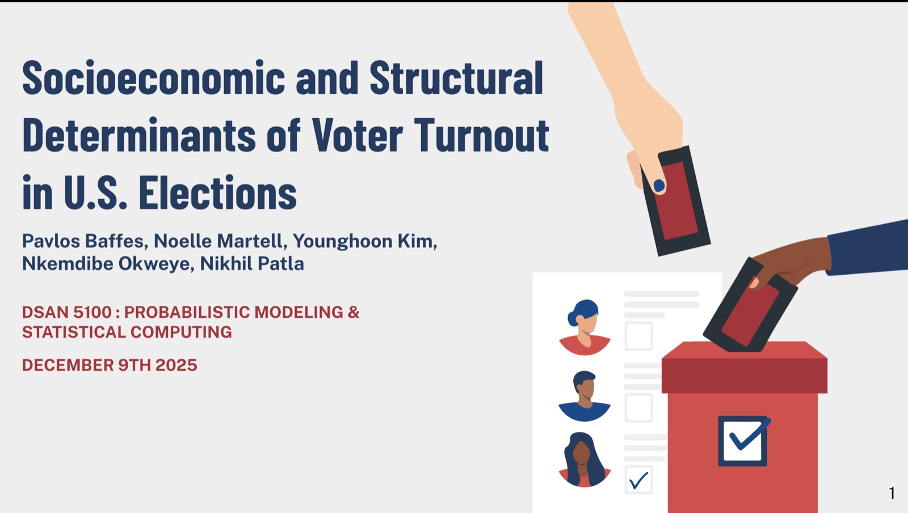

```{=html}
<div class="cs-facts">
  <div><span>Team</span>Pavlos Baffes, Noelle Martell, Younghoon Kim, Nkem Okweye, Nikhil Patla</div>
  <div><span>Course</span>DSAN 5100, Probabilistic Modeling &amp; Statistical Computing</div>
  <div><span>Data</span>23 elections · 6 states · 1980–2024</div>
  <div><span>Tools</span>R, Python, Quarto</div>
</div>

```

## The question

Turnout swings a lot between states and elections. We asked whether the conditions people live with, such as unemployment, housing costs, crime and cost of living, predict participation better than civic duty alone.

## Data

Turnout from the University of Florida Election Lab, joined with FRED economic series (unemployment, median household income, housing price index), FBI violent-crime rates, NOAA Election Day weather and U.S. Census population, for New York, California, Ohio, Michigan, Florida and Utah.

## Method

```{=html}
<div class="methods"><span>one-way ANOVA</span><span>Welch’s ANOVA</span><span>chi-square</span><span>permutation tests</span><span>bootstrap</span><span>ARIMA</span><span>Bonferroni</span><span>Games-Howell</span></div>
```

We checked assumptions with Shapiro-Wilk and Levene's tests before each comparison, and used post-hoc procedures across 12+ hypothesis tests. ARIMA models forecast 2026 unemployment for Florida, California and Michigan.

## Results

```{=html}
<div class="results">
  <div class="res"><b>+5.47</b><span>pts turnout, swing vs. blue states (presidential)</span><i>p = 0.0012</i></div>
  <div class="res"><b>~5</b><span>pts higher presidential turnout in high-HPI states</span><i>p = 0.0007</i></div>
  <div class="res"><b>+4.35</b><span>pts, medium- vs. high-crime elections</span><i>p = 0.004</i></div>
</div>
```

Weather had no significant effect on turnout, and all three forecast states point to rising unemployment going into the 2026 midterms.

## What it means

Turnout responds to the conditions voters live in, not only to partisanship. Campaigns can use local economic conditions to understand which issues will move people to vote.

```{=html}
<div class="btns" style="margin-top:2rem">
  <a class="btn-pill p" href="https://nko123.github.io/DSAN-5100-Final-Project/">Read the full report ↗</a>
  <a class="btn-pill s" href="../work.html">← All projects</a>
</div>
```
